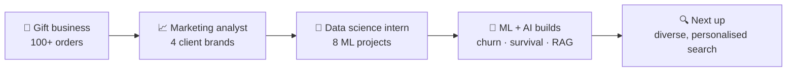
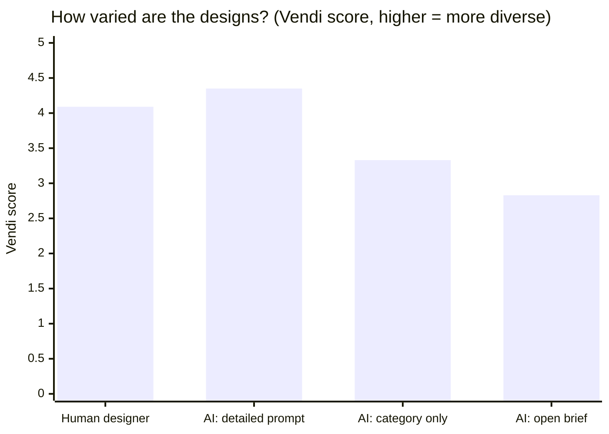

# Hey, I'm Maryam 👋
 
**I build things that think, and then I check whether they're thinking *differently enough*.**
 
CS grad from Lahore 🇵🇰. I've sold handmade gifts, grown brands on social media, and trained the models that predict who'll leave and what to show next. Now I'm working on one question:
 
> **When the algorithm picks for you, does everyone end up seeing the same thing?**
 
---
 
## 📖 My story in 5 data points
 

 

<b>📍 Data point 1: 80K+ monthly Pinterest views</b> (click to open)

 
I started **Gifts by Muskurahatt** with PKR 10,000 and grew it to **PKR 300K+ in first-year revenue**, **100+ orders** and **80K+ monthly Pinterest views**.
 
The thing I remember most is how hard it was to find *niche* gift ideas online. Everyone's feed looked the same. That frustration became my research question.
 

<b>📍 Data point 2: 144 → 1,200 followers</b>

 
1+ year as a Digital Marketing Analyst at Utilis BPO, managing social strategy and analytics for international brands. Grew one client's LinkedIn from **144 to 1,200 followers**, drove **USD 5,000** in attributed Klaviyo revenue, and built a **50+ page** corporate website.
 
Because data is data, whether it's model accuracy or follower curves.
 

<b>📍 Data point 3: 31% less diverse</b> (my research)

 
I compared **30 of my own handmade gift designs** with **90 images from Stable Diffusion XL**, measuring diversity in CLIP embedding space with the **Vendi score** and permutation tests.
 
The more freedom the model got, the more alike its designs became:
 

 
| Prompt given to the AI | Diversity vs human | Significant? |
|---|---|---|
| Detailed description | about the same | no (p = 0.76) |
| Product category only | **18% lower** | yes (p = 0.011) |
| One open brief | **31% lower** | yes (p = 0.001) |
 
Plot twist I had to fix first: a 15% gap on raw photos turned out to be mostly *backgrounds*. It disappeared once I removed them with U2-Net.
 
🔬 *Now expanding it to 75 real designs and three prompting strategies.*
 

<b>📍 Data point 4: MRR@10 0.767 → 0.844</b> (models I've shipped)

 
| Project | What it does | The number I'm proud of |
|---|---|---|
| 🛒 **Dimaagi Cart** | Predicts silent churn from 1.47M transactions, explains it with SHAP, and writes cited win-back campaigns with hybrid RAG. Shipped as a Windows app | ROC-AUC **0.764** · MRR@10 **0.844** · **97%** faithfulness over 229 claims |
| 🎗️ **Breast Cancer Survival Prediction** | Survival model on METABRIC with a React + FastAPI app. I caught and removed duplicate-patient leakage first | External validation on **1,071** TCGA patients, C-index **0.709** |
| 🤖 **BDOMate.AI** | AI platform for a university Business Development Office: MOUs, outreach, event and sponsor intelligence. Flutter + FastAPI + LLMs + Twilio | **58** REST endpoints · **50/50** tests passing · piloted in our university's BDO |
| 🌙 **Lunar Kids Quest** | NASA Space Apps Challenge 2026: a Moon-mission trainer game for kids, using live NASA space-weather data. [Play it →](https://lunar-kids-quest.vercel.app) | My first hackathon, as project lead |
| 📉 **Customer Churn Predictor** | XGBoost + SHAP + FastAPI with a custom JS dashboard and a growth-scenario engine | Built on H&M's fashion recommendation dataset |
| 🛠️ **Kaamu** *(in progress)* | Home-services marketplace with two-sided bidding | Coming soon 👀 |
 

<b>📍 Data point 5: top 18%</b>

 
- 🏆 **82.7th percentile** (top 18%) of 33K+ students in Pakistan's National Skill Competency Test (NSCT), conducted by HEC
- 🌍 Selected for the **Aspire Leaders Program**, Cohort 4 (2026)
- 🚀 **NASA Space Apps Challenge 2026** participant
- 🎓 Google Data Analytics Certified · Google Advanced Data Analytics *(in progress)*

---
 
## 🧰 What I work with
 
| | |
|---|---|
| **ML & evaluation** | Scikit-learn · XGBoost · SHAP · scikit-survival · CLIP · Vendi score · permutation testing |
| **Generative & retrieval** | Stable Diffusion XL · BGE embeddings · BM25 · ChromaDB · cross-encoder reranking · Gemini API |
| **Backend** | FastAPI · PostgreSQL · REST APIs · JWT auth · Docker |
| **Frontend & apps** | Flutter · Dart · React · Electron · HTML/CSS/JS |
| **Data** | Pandas · NumPy · Matplotlib · Seaborn · Tableau · R *(learning)* · Jupyter · Colab |
| **Automation & tools** | n8n · Git · Streamlit · WordPress |
 
---
 
## 🔭 Right now
 
- 🔬 Running the 75-image version of my diffusion diversity study
- 📚 Learning how ranking and recommendation work at scale
- 🤝 Open to **ML engineering** roles and research collaborations
---
 
📬 maryam.adeeba87@gmail.com · 💼 [LinkedIn](https://linkedin.com/in/maryam-adeeba-535a1b254)
 
Always happy to talk about recommendation systems, creative AI, or why my cats ignore every algorithm I build. 🐈
 
